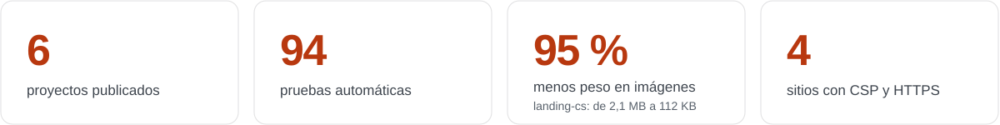
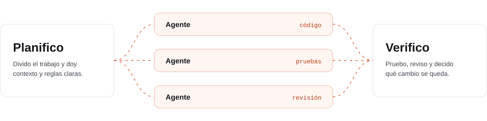

<picture>
  <source media="(prefers-color-scheme: dark)" srcset="assets/banner-oscuro.svg">
  
</picture>

Estudio Ingeniería de Sistemas en la Universidad Santo Tomás, en Tunja, y soy Técnico en Sistemas del SENA. Me gusta construir software que se pueda usar de verdad: aplicaciones de escritorio en Java con su base de datos y sus pruebas, y sitios web rápidos, accesibles y publicados. También trabajo con agentes de IA, incluso varios en paralelo, y reviso todo lo que producen antes de aceptarlo.

<picture>
  <source media="(prefers-color-scheme: dark)" srcset="assets/cifras-oscuro.svg">
  
</picture>

## Sitios web

<table>
  <tr>
    <td width="50%" valign="top">
      
      <h3>Templvm</h3>
      Historia de la Orden del Temple, seis castillos con su foto y una tienda con carrito de compras.
        
      <code>Bootstrap 5</code> <code>JavaScript</code>
        
      <a href="https://templvm-kyotto44.netlify.app"><b>Ver sitio</b></a> &nbsp;&nbsp; <a href="https://github.com/kyotto44/templvm">Código</a>
    </td>
    <td width="50%" valign="top">
      
      <h3>PitLane</h3>
      Portal de Fórmula 1 con pilotos, clasificación, circuitos, club de fans y preferencias que se guardan.
        
      <code>HTML</code> <code>CSS</code> <code>JavaScript</code>
        
      <a href="https://pitlane-kyotto44.netlify.app"><b>Ver sitio</b></a> &nbsp;&nbsp; <a href="https://github.com/kyotto44/pitlane">Código</a>
    </td>
  </tr>
  <tr>
    <td width="50%" valign="top">
      
      <h3>MatchPoint</h3>
      Resultados, calendario, equipos y tabla de posiciones de cuatro ligas europeas, con filtros por liga.
        
      <code>Tailwind CSS</code> <code>JavaScript</code>
        
      <a href="https://matchpoint-kyotto44.netlify.app"><b>Ver sitio</b></a> &nbsp;&nbsp; <a href="https://github.com/kyotto44/matchpoint">Código</a>
    </td>
    <td width="50%" valign="top">
      
      <h3>Táctica y ejecución</h3>
      Landing que explica cómo se construye software con la metáfora de una ronda de Counter-Strike.
        
      <code>HTML</code> <code>CSS</code> <code>JavaScript</code>
        
      <a href="https://landing-cs-kyotto44.netlify.app"><b>Ver sitio</b></a> &nbsp;&nbsp; <a href="https://github.com/kyotto44/landing-cs">Código</a>
    </td>
  </tr>
</table>

## Aplicaciones de escritorio

### SanRafa

Registro de pacientes, agenda de citas por médico e historias clínicas para un hospital, con validaciones según la edad del paciente. La base de datos se crea sola la primera vez que se abre. Proyecto académico.

<code>Java</code> <code>JavaFX</code> <code>SQLite</code> <code>JUnit</code> &nbsp; 46 pruebas automáticas &nbsp;&nbsp; <a href="https://github.com/kyotto44/sanrafa-app"><b>Ver código</b></a>

<table>
  <tr>
    <td width="58%" valign="top">
      
    </td>
    <td width="42%" valign="top">
      <h3>Dashboard de talento humano</h3>
      Muestra en una sola pantalla quién está de vacaciones o en permiso hoy, quién lleva más de un año sin tomarlas y cuántas personas se retiran cada mes.
        
      Tiene modo demostración para probarlo sin instalar MySQL.
        
      <code>Java</code> <code>JavaFX</code> <code>MySQL</code> <code>JDBI</code> <code>JUnit</code>
        
      48 pruebas automáticas
        
      <a href="https://github.com/kyotto44/dashboard-gobernacion"><b>Ver código</b></a>
    </td>
  </tr>
</table>

## Lo que sé hacer

Todo esto se puede ver en el código y en los archivos `CAMBIOS.md` de cada proyecto.

<table>
  <tr>
    <td width="50%" valign="top">
      <h3>Java y escritorio</h3>
      <ul>
        <li>Interfaces con JavaFX, FXML y hojas de estilo propias que se adaptan al tamaño de la ventana.</li>
        <li>Diseño en capas: la interfaz <code>DataSource</code> tiene una versión MySQL y otra en memoria, y las dos pasan la misma batería de pruebas.</li>
        <li>Modelos inmutables con <code>record</code>, fechas con <code>LocalDate</code> y validaciones separadas de las pantallas.</li>
        <li>94 pruebas con JUnit 5 y proyectos Gradle que descargan sus dependencias solos.</li>
      </ul>
    </td>
    <td width="50%" valign="top">
      <h3>Bases de datos</h3>
      <ul>
        <li>MySQL con JDBI y SQLite con JDBC, siempre con <code>PreparedStatement</code>.</li>
        <li>Reglas en la propia base: llaves foráneas, borrado en cascada, valores únicos y restricciones de estados y fechas.</li>
        <li>Transacciones para que un borrado no deje datos a medias, y una consulta agrupada en lugar de doce.</li>
        <li>Scripts de esquema, datos de ejemplo y migración.</li>
      </ul>
    </td>
  </tr>
  <tr>
    <td width="50%" valign="top">
      <h3>Desarrollo web</h3>
      <ul>
        <li>HTML semántico, CSS con variables, Grid y diseño responsive, y JavaScript sin frameworks.</li>
        <li>Tailwind CSS compilado para producción y Bootstrap personalizado con sus propias variables.</li>
        <li>Interacciones con <code>IntersectionObserver</code>, Web Animations API y <code>localStorage</code> protegido.</li>
        <li>Mejora progresiva: sin JavaScript el contenido se sigue viendo.</li>
      </ul>
    </td>
    <td width="50%" valign="top">
      <h3>Accesibilidad</h3>
      <ul>
        <li>Contraste WCAG AA revisado color por color.</li>
        <li>Navegación con teclado: foco visible, menús que se cierran con Escape y ventanas que no dejan escapar el foco.</li>
        <li>Errores de formulario debajo de cada campo, atributos ARIA y respeto por la opción de reducir movimiento.</li>
        <li>Botones y enlaces de al menos 44 px en celular.</li>
      </ul>
    </td>
  </tr>
  <tr>
    <td width="50%" valign="top">
      <h3>Rendimiento y recursos</h3>
      <ul>
        <li>Imágenes en WebP con <code>srcset</code> y carga diferida. En PitLane pasaron de 7,1 MB a 0,8 MB.</li>
        <li><code>width</code> y <code>height</code> en cada imagen para que la página no salte al cargar.</li>
        <li>Dependencias sin uso retiradas y un SDK de 112 MB sacado del repositorio.</li>
        <li>Tailwind compilado en lugar del CDN que generaba el CSS en cada visita.</li>
      </ul>
    </td>
    <td width="50%" valign="top">
      <h3>Seguridad y publicación</h3>
      <ul>
        <li>Cabeceras de seguridad en Netlify: CSP, HTTPS obligatorio, <code>X-Frame-Options</code> y <code>nosniff</code>.</li>
        <li>Integridad (SRI) en los archivos que llegan desde un CDN.</li>
        <li>Contraseñas fuera del código, con variables de entorno y <code>.gitignore</code>, y sin datos personales reales en los repositorios.</li>
        <li>Git y GitHub para el control de versiones, y Netlify para publicar.</li>
      </ul>
    </td>
  </tr>
</table>

## Cómo trabajo con IA

<picture>
  <source media="(prefers-color-scheme: dark)" srcset="assets/ia-oscuro.svg">
  
</picture>

Sé coordinar varios agentes de IA al mismo tiempo, cada uno en una tarea separada y sin que se pisen entre sí. Para mí, usar bien la IA significa:

- **Dar buen contexto.** Explico qué se busca, qué se puede tocar y cómo se va a comprobar el resultado.
- **Dividir el trabajo.** Reparto tareas independientes para que los agentes avancen en paralelo.
- **Verificar todo.** Pruebo, leo y entiendo cada cambio antes de aceptarlo. Si no lo entiendo, no entra.
- **Cuidar lo que se publica.** Ni credenciales, ni datos personales, ni código sin revisar en un repositorio público.

## Formación

<picture>
  <source media="(prefers-color-scheme: dark)" srcset="assets/formacion-oscuro.svg">
  
</picture>

## Tecnologías

   &nbsp;
   &nbsp;
   &nbsp;
   &nbsp;
   &nbsp;&nbsp;&nbsp;&nbsp;
   &nbsp;
   &nbsp;
   &nbsp;
   &nbsp;
   &nbsp;&nbsp;&nbsp;&nbsp;
   &nbsp;
   &nbsp;
   &nbsp;
  

Cada proyecto tiene su README con capturas, cómo ejecutarlo y qué cambió desde la entrega original.
