<picture>
  <source media="(prefers-color-scheme: dark)" srcset="assets/banner-oscuro.svg">
  
</picture>

Estudio Ingeniería de Sistemas en la Universidad Santo Tomás, en Tunja, y soy Técnico en Sistemas del SENA. Me gusta construir software que se pueda usar de verdad: aplicaciones de escritorio en Java con su base de datos y sus pruebas, y sitios web rápidos, accesibles y publicados.

## Sitios web

<table>
  <tr>
    <td width="50%" valign="top">
      
      <h3>Templvm</h3>
      Historia de la Orden del Temple, seis castillos con su foto y una tienda con carrito de compras.
        
      <code>Bootstrap 5</code> <code>JavaScript</code>
        
      <a href="https://templvm-kyotto44.netlify.app"><b>Ver sitio</b></a> &nbsp;&nbsp; <a href="https://github.com/kyotto44/templvm">Código</a>
    </td>
    <td width="50%" valign="top">
      
      <h3>PitLane</h3>
      Portal de Fórmula 1 con pilotos, clasificación, circuitos, club de fans y preferencias que se guardan.
        
      <code>HTML</code> <code>CSS</code> <code>JavaScript</code>
        
      <a href="https://pitlane-kyotto44.netlify.app"><b>Ver sitio</b></a> &nbsp;&nbsp; <a href="https://github.com/kyotto44/pitlane">Código</a>
    </td>
  </tr>
  <tr>
    <td width="50%" valign="top">
      
      <h3>MatchPoint</h3>
      Resultados, calendario, equipos y tabla de posiciones de cuatro ligas europeas, con filtros por liga.
        
      <code>Tailwind CSS</code> <code>JavaScript</code>
        
      <a href="https://matchpoint-kyotto44.netlify.app"><b>Ver sitio</b></a> &nbsp;&nbsp; <a href="https://github.com/kyotto44/matchpoint">Código</a>
    </td>
    <td width="50%" valign="top">
      
      <h3>Táctica y ejecución</h3>
      Landing que explica cómo se construye software con la metáfora de una ronda de Counter-Strike.
        
      <code>HTML</code> <code>CSS</code> <code>JavaScript</code>
        
      <a href="https://landing-cs-kyotto44.netlify.app"><b>Ver sitio</b></a> &nbsp;&nbsp; <a href="https://github.com/kyotto44/landing-cs">Código</a>
    </td>
  </tr>
</table>

## Aplicaciones de escritorio

### SanRafa

Registro de pacientes, agenda de citas por médico e historias clínicas para un hospital, con validaciones según la edad del paciente. La base de datos se crea sola la primera vez que se abre. Proyecto académico.

<code>Java</code> <code>JavaFX</code> <code>SQLite</code> <code>JUnit</code> &nbsp; 46 pruebas automáticas &nbsp;&nbsp; <a href="https://github.com/kyotto44/sanrafa-app"><b>Ver código</b></a>

<table>
  <tr>
    <td width="58%" valign="top">
      
    </td>
    <td width="42%" valign="top">
      <h3>Dashboard de talento humano</h3>
      Muestra en una sola pantalla quién está de vacaciones o en permiso hoy, quién lleva más de un año sin tomarlas y cuántas personas se retiran cada mes.
        
      Tiene modo demostración para probarlo sin instalar MySQL.
        
      <code>Java</code> <code>JavaFX</code> <code>MySQL</code> <code>JDBI</code> <code>JUnit</code>
        
      48 pruebas automáticas
        
      <a href="https://github.com/kyotto44/dashboard-gobernacion"><b>Ver código</b></a>
    </td>
  </tr>
</table>

## Formación

<picture>
  <source media="(prefers-color-scheme: dark)" srcset="assets/formacion-oscuro.svg">
  
</picture>

## Tecnologías

   &nbsp;
   &nbsp;
   &nbsp;
   &nbsp;
   &nbsp;&nbsp;&nbsp;&nbsp;
   &nbsp;
   &nbsp;
   &nbsp;
   &nbsp;
   &nbsp;&nbsp;&nbsp;&nbsp;
   &nbsp;
   &nbsp;
   &nbsp;
  

Cada proyecto tiene su README con capturas, cómo ejecutarlo y qué cambió desde la entrega original.
