**Hola, soy Santiago Angarita.** Estudio Ingeniería de Sistemas en la Universidad Santo Tomás y ya tengo mi título de Técnico en Sistemas del SENA. Lo que más me gusta es construir cosas que la gente use de verdad: páginas que abren rápido en cualquier celular y aplicaciones de escritorio que guardan bien la información y no fallan cuando alguien llena mal un formulario.

Nada de lo que vas a ver aquí abajo se quedó guardado en una carpeta. Son **cuatro sitios publicados** que puedes abrir ahora mismo y **dos aplicaciones en Java con 94 pruebas automáticas** que comprueban que todo funcione: una maneja pacientes, citas e historias clínicas, y la otra lleva las vacaciones, los permisos y los retiros del personal de una gobernación. Cada proyecto tiene su `CAMBIOS.md`, donde cuento qué arreglé y por qué. Para mí entregar no es solo que se vea bonito: es que funcione y que cualquiera lo pueda entender y mantener después.

### Por qué trabajar conmigo

- **Me fijo en lo que no se ve, pero se siente.** A PitLane le bajé el peso de 7,1 MB a 0,8 MB para que cargue rápido. Reviso que los colores se lean bien, que todo se pueda usar con teclado y con lector de pantalla, y que los sitios salgan con HTTPS y cabeceras de seguridad bien puestas.
- **Uso la IA a mi favor, pero con criterio.** Pongo varios agentes de IA a trabajar al mismo tiempo: uno en el código, otro en las pruebas, otro revisando. Yo planeo, reviso cada cambio y decido qué se queda. Así avanzo mucho más rápido sin entregar nada que no haya revisado yo mismo.
- **Te hablo claro.** Desde el principio te digo qué se puede hacer, cómo lo voy a hacer y qué cambió en cada entrega, sin palabras raras.
- **Aprendo lo que el proyecto pida.** Ya trabajé con Java, JavaFX, MySQL, SQLite, HTML, CSS, JavaScript, Tailwind y Bootstrap, y si tu proyecto necesita otra herramienta, la aprendo y la aplico.

Trabajo de forma remota, desde cualquier lugar. Si tienes un negocio y necesitas tu página, si ya tienes un sitio y quieres que funcione mejor, o si necesitas una app para organizar la información de tu equipo, [escríbeme](https://mail.google.com/mail/?view=cm&fs=1&to=kyottondea@gmail.com&su=Proyecto%20desde%20GitHub) y lo hablamos. Y si estás buscando talento para tu equipo, abre cualquier repositorio: todo el código está ahí para que lo revises.

## Proyectos

<a href="https://templvm-kyotto44.netlify.app"></a><a href="https://github.com/kyotto44?tab=repositories"></a><a href="https://mail.google.com/mail/?view=cm&amp;fs=1&amp;to=kyottondea@gmail.com&amp;su=Proyecto%20desde%20GitHub"></a><a href="https://pitlane-kyotto44.netlify.app"></a><a href="https://matchpoint-kyotto44.netlify.app"></a><a href="https://landing-cs-kyotto44.netlify.app"></a><a href="https://github.com/kyotto44/sanrafa-app"></a><a href="https://github.com/kyotto44/dashboard-gobernacion"></a>

Cada tarjeta abre el sitio publicado o el código. Todos los repositorios tienen un `CAMBIOS.md` con lo que se corrigió y por qué.

## Servicios

<a href="https://mail.google.com/mail/?view=cm&amp;fs=1&amp;to=kyottondea@gmail.com&amp;su=Proyecto%20desde%20GitHub"></a>

## Lo que sé hacer

## Cómo trabajo con IA


## Formación


## Tecnologías

   &nbsp;
   &nbsp;
   &nbsp;
   &nbsp;
   &nbsp;&nbsp;&nbsp;&nbsp;
   &nbsp;
   &nbsp;
   &nbsp;
   &nbsp;
   &nbsp;&nbsp;&nbsp;&nbsp;
   &nbsp;
   &nbsp;
   &nbsp;
  

## Contacto

<a href="https://mail.google.com/mail/?view=cm&amp;fs=1&amp;to=kyottondea@gmail.com&amp;su=Proyecto%20desde%20GitHub"></a>

Escríbeme a **kyottondea@gmail.com**: [abrir en Gmail](https://mail.google.com/mail/?view=cm&fs=1&to=kyottondea@gmail.com&su=Proyecto%20desde%20GitHub) o [usar mi app de correo](mailto:kyottondea@gmail.com?subject=Proyecto%20desde%20GitHub).
